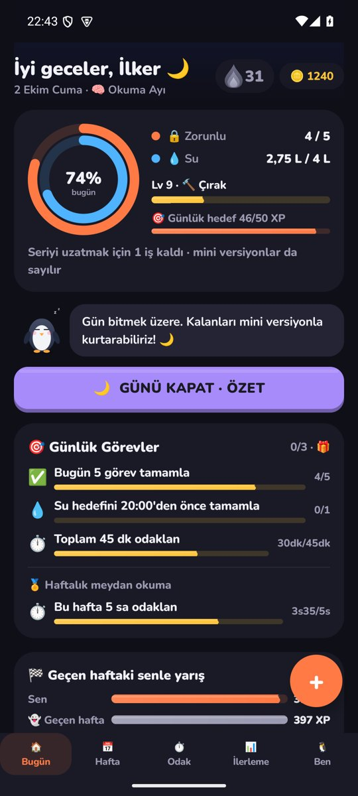
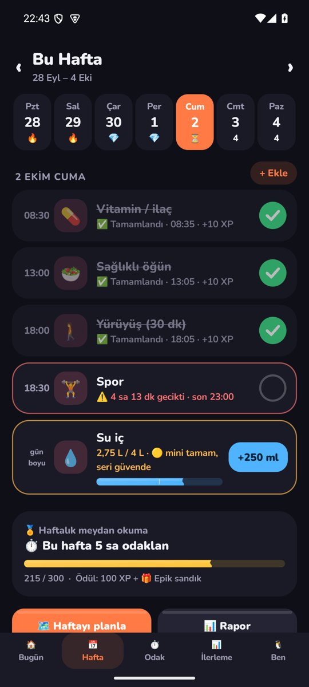
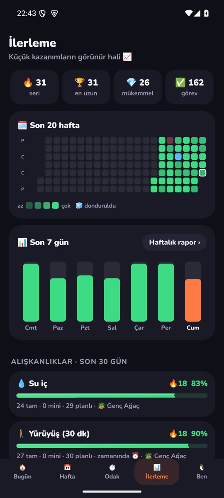
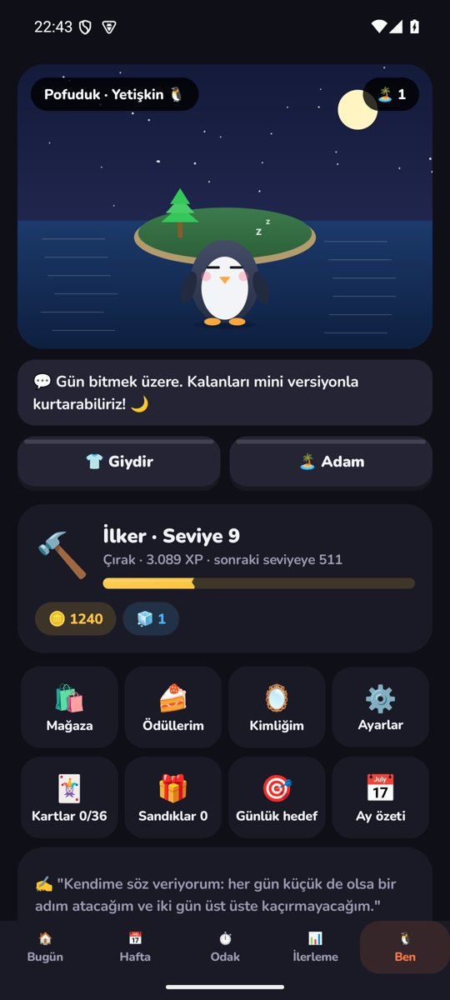

# Rutin — Kalıcı Alışkanlıklar İçin Android Uygulaması

  

**Hiç rutin tutturamamış insanlar için tasarlanmış bir alışkanlık uygulaması.** Kaçırılan günü cezalandırmak yerine kullanıcıya uyum sağlar: akıllı bildirimler doğru zamanda dürter, "rutin kalkanı" kötü bir günde seriyi korur, sevimli bir yoldaş (Pofuduk) ve oyunlaştırma kullanıcıyı geri getirir.

> *English summary below.*

<p align="center">
  
  
  
  
  
</p>

## Ürün fikri

Çoğu alışkanlık uygulaması "zinciri kırma" baskısıyla çalışır ve ilk kaçırılan günde terk edilir. Rutin'in tasarımı, [`PLAN.md`](PLAN.md)'deki 18 bölümlük ürün dokümanında anlatılan davranış psikolojisi ilkelerine dayanıyor: küçük başlangıçlar, "mini versiyon" ile kısmi başarı, iki kez üst üste kaçırmama kuralı, değişken ödüller ve kimlik odaklı motivasyon.

## Özellikler

- 🔔 **Akıllı bildirim motoru:** Saatli görevlerde kademeli yükselen hatırlatmalar (erken yaparsan susar, geciktikçe sıklaşır); su gibi sayaçlı hedeflerde "beklenen ilerleme eğrisine" göre uyarı; günlük **bildirim bütçesi** ile spam koruması; kullanıcının en çok tepki verdiği saatleri öğrenme
- 🛡️ **Rutin kalkanı:** Plan dışı bir olay olduğunda günü otomatik yeniden planlar; seri dondurma, seri onarma, hastalık ve tatil modu, geri dönüş protokolü
- ⏱️ **Odak modu:** Pomodoro oturumları, günlük süre hedefi, büyüyen "odak ormanı"
- 🎮 **Oyunlaştırma:** XP ve seviye, Bronz–Elmas kademeli 45'ten fazla rozet, sandıklar, coin ekonomisi, günlük ve haftalık görevler, yaşam alanı istatistikleri, sanal yoldaş ve "hayat adası"
- 📊 **Analiz:** 20 haftalık ısı haritası, son 7 gün grafiği, alışkanlık bazında 30 günlük başarı, haftalık rapor ve ay özeti
- 🏠 **Widget'lar:** Seri, su (+250 ml butonlu) ve "Bugün" (işaretlenebilir) widget'ları
- 🔕 Bildirimden tek dokunuşla tamamlama, mini versiyon, erteleme

## Mühendislik

- **Sıfır bağımlılık, Gradle yok:** 52 Java dosyası (~8.500 satır) doğrudan Android SDK ile yazıldı. [`rutin/build.ps1`](rutin/build.ps1) `aapt2 → javac → d8 → zipalign → apksigner` hattını kendisi çalıştırıyor; derleme saniyeler sürüyor ve APK yalnızca ~1 MB.
- **Katmanlı yapı:** `core/` (saf Java iş mantığı: motor, planlayıcı, bildirim motoru, rozetler, görevler), `data/` (atomik JSON kalıcılığı + yedek dosyası), `ui/` (kodla kurulan arayüz, sheet bileşenleri), `sys/` (AlarmManager zamanlaması, bildirimler, odak servisi, açılışta yeniden kurma), `widget/` (ana ekran widget'ları).
- **Test edilebilir çekirdek:** İş mantığı Android'den bağımsız; [`rutin/tests/CoreTest.java`](rutin/tests/CoreTest.java) derleme sırasında masaüstü JVM'de çalışıyor.
- **Sesler kodla üretiliyor:** `tools/GenSounds.java` bildirim ve kutlama seslerini derleme anında sentezliyor; hazır ses dosyası yok.
- **Dayanıklı kalıcılık:** Durum önce geçici dosyaya yazılıp atomik olarak taşınıyor, bir önceki sürüm yedek olarak tutuluyor; dışa/içe aktarım JSON ile.

## Derleme ve kurulum

```powershell
# JDK 17 + Android SDK (platform 35, build-tools 35) gerekir
powershell -ExecutionPolicy Bypass -File rutin/build.ps1        # testler + imzalı APK
```

Telefona kurulum ve ilk kullanım adımları: [`KURULUM.md`](KURULUM.md)

---

## English

**Rutin** ("routine") is a native Android habit app for people who have never managed to keep a routine. Instead of punishing missed days it adapts: an escalating, budget-limited notification engine, a "routine shield" that re-plans the day and protects the streak, a focus mode, and a full gamification layer (XP, 45+ tiered badges, chests, a virtual companion). It is written in plain Java against the Android SDK with **zero third-party dependencies and no Gradle** — a custom PowerShell pipeline (aapt2 → javac → d8 → zipalign → apksigner) builds a ~1 MB APK in seconds, and the pure-Java core is unit-tested on the desktop JVM during the build.

## Lisans

MIT © 2026 İlker Tokat
